# ELECTRA · 电力系统一次设计与分析平台

一个面向电力工程方案设计的浏览器端工作台：在可交互单线图上绘制一次主接线，配置母线、线路、双绕组/三绕组变压器、电源、负荷和补偿装置，完成节点导纳矩阵组集、牛顿-拉夫逊 / PQ 分解 / 高斯-赛德尔 / 直流潮流计算，并进一步做继电保护整定与灵敏度扫描、三/两/单相短路校验、N-1 静态安全扫描、经典暂态稳定仿真、网损/成本优化和多运行场景对比。

> 全部计算在浏览器本地完成，不需要后端、不需要安装数据库。工程文件以 JSON 保存，Excel / CSV / CIM / BPA 风格数据可导出。内置 3 套示例，其中包含一套 25 节点复杂大电网。

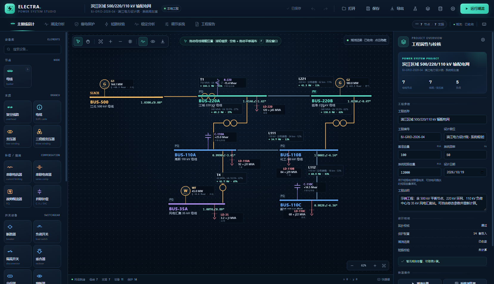

---

## 快速开始

### 使用当前服务

打开 <http://127.0.0.1:5188>。

### 本地启动

要求：Windows + Python 3（仅用于静态文件服务），或任意静态 HTTP 服务器。

```bat
cd /d F:\dshSoftware
python -m http.server 5188 --bind 127.0.0.1
```

然后访问 <http://127.0.0.1:5188>。也可以双击 `start.bat`。

首次打开后，点击顶部烧瓶图标或左侧“加载示例电网”，可从示例库切换区域电网、工业园区和 25 节点大电网。

> 应用使用 ES Modules，请通过 HTTP 访问，不要直接用 `file://` 打开 `index.html`。建议使用最新版 Chrome / Edge。

---

## 功能一览

### 1. 电气一次主接线绘制

- 设备库：母线、架空线路 / 电缆、双绕组/三绕组变压器、**串联电抗器、串联电容器、故障电流限制器**、**断路器、负荷开关、隔离开关、重合器、分段器、熔断器**、发电机、负荷、并联电容器 / 电抗器 / 滤波器 / SVC / STATCOM。
- 画布支持拖动母线、滚轮缩放、空格拖动画布、适应窗口、网格与吸附布局。
- 线路 / 变压器端点根据母线相对方位自动分配端口，支持多条支路、自动正交路由。
- 三绕组变压器按“高压侧 → 中压侧 → 低压侧”顺序连续选择三条母线；画布使用三圆圈星形符号并自动避让母线。
- 断路器 / 隔离开关按零阻抗支路处理，合闸时自动合并两端节点；分闸时退出计算。
- 线路、双绕组和三绕组变压器均可配置各侧开关状态，支持检修与停运方式。
- 支持撤销 / 重做、复制、删除、自动保存、JSON 工程导入导出、SVG / PNG 单线图导出。
- 计算结果可叠加到单线图上：母线电压、支路有功、方向箭头、负载率、越限颜色；三绕组显示三侧绕组功率。
- 画布工具栏提供“简洁 / 完整标注”切换：大型电网默认只显示设备与支路编号，避免标签堆叠；需要参数时再切回完整标注。
- 加载示例或工程后自动“适应窗口”，大网可滚轮缩放、空格拖动平移。

### 2. 参数化设备模型

| 设备 | 主要参数 |
| --- | --- |
| 母线 | 额定电压、节点类型（Slack/PV/PQ）、电压幅值、相角、短路耐受电流、画布位置与宽度 |
| 线路 | **架空线 / 电缆**、分布 / 集中参数、长度、r₁/x₁/b₁ 或总 R/X/B、**零序 r₀/x₀/b₀ 或 R₀/X₀/B₀**、电压等级、热稳定容量、导线/电缆型号、绝缘类型、允许载流量 |
| 双绕组变压器 | 额定容量、额定电压、Uk%、Pk、P0、I0%、分接头、相角偏移、联结组别、冷却方式、**零序通路与 Uk₀** |
| 三绕组变压器 | 容量、三侧额定电压、Uk(HM/HL/ML)、Pk、P0、I0%、三侧分接头、联结组别 |
| 发电机 | 有功、无功、Q 上下限、额定容量、电源类型、惯性时间常数、x′d、**零序接地电抗 xg0、中性点接地**、P 上下限、成本系数 |
| 负荷 | P、Q、负荷类型、功率因数、**电动机反馈开关与次暂态电抗** |
| 并联补偿 | 电容器 / 电抗器 / 滤波器 / SVC / STATCOM、Mvar、额定电压 |
| 串联补偿 / 限流 | 串联电抗器、串联电容器、故障电流限制器（正常态 / 故障态阻抗） |
| 开关设备 | 断路器、负荷开关、隔离开关、重合器、分段器、熔断器；合分状态、额定/开断电流、重合参数 |

**补偿与限流设备**

- 并联补偿：电容器、电抗器、无源滤波器、SVC、STATCOM，按静态无功等值参与潮流；SVC/STATCOM 的 q 可在属性中设置正/负。
- 串联补偿：串联电容器以负电抗补偿线路；串联电抗器限制短路电流与并联支路涌流。
- 故障电流限制器：正常潮流使用正常态电抗，短路计算自动切换为故障态高电抗。

**开关设备**

- 断路器、负荷开关、隔离开关、重合器、分段器、熔断器均按合分状态参与网络合并。
- 负荷开关记录负荷开断电流；重合器记录重合次数与间隔；分段器记录动作计数；熔断器记录开断能力。
- 线路自动重合闸可生成时序；熔断器熔断过程与分段器计数目前作为定值记录，不在稳态潮流/短路中自动推演。

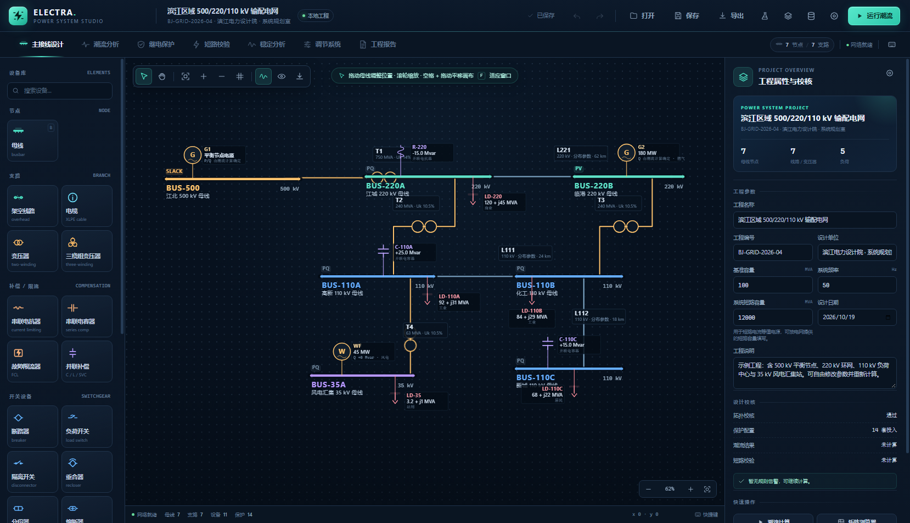

线路支持两种正序模型，并可在切换时保留物理参数：

- **集中参数**：总 R、X、B，使用 π 型等值电路。
- **分布参数**：每公里 r、x、b，使用长线双曲函数修正：
  - \(Z' = Z_c \sinh(\gamma l)\)
  - \(Y'/2 = \frac{1}{Z_c}\tanh(\gamma l/2)\)
  - 自动生成精确等效 π 型电路，并在属性面板显示修正后的 R/X/B 与充电功率。

零序参数用于单相接地短路，不参与正序潮流；缺省值按 \(x_0 \approx 3x_1\)、\(b_0 \approx 0.8b_1\) 估算，正式工程应改为实测或设计值。

### 3. 三绕组变压器与零序网络

**三绕组变压器**采用星形等值：

\[
u_H=\frac{u_{HM}+u_{HL}-u_{ML}}{2},\quad
u_M=\frac{u_{HM}+u_{ML}-u_{HL}}{2},\quad
u_L=\frac{u_{HL}+u_{ML}-u_{HM}}{2}
\]

每侧绕组折算到系统基准后接一个虚拟星点，星点作为内部 PQ 节点参与牛顿法求解。三侧分接头按各自额定电压与母线基准电压折算；高压侧附加励磁支路。结果表按 `T-H / T-M / T-L` 输出三侧功率、损耗与负载率，N-1 扫描把三绕组作为一个整体停运。

**零序网络**只保留物理母线节点，按以下方式组集：

- 线路：使用零序 R₀/X₀/B₀ 的 π 型电路（不做双曲修正）。
- 双绕组变压器：`零序通路` 可选 `through`（两侧接地、零序穿越）、`ground_from`（仅高压侧接地）、`ground_to`（仅低压侧接地）、`block`（阻断）。零序阻抗由 `Uk₀` 折算。
- 发电机：中性点接地时以 `xg0` 并联到零序网络；外部系统在平衡节点提供零序等值电源。
- 三绕组变压器：当前版本零序通路按**阻断**处理，三侧差动保护也不在本版本自动建模。

零序网络中没有物理接地通路的部分会加入极小对地电导作数值正则化，使单相故障电流趋近于零而不是直接报矩阵奇异；若故障电流接近零，应检查变压器中性点接地方式。

### 4. 节点导纳矩阵与雅可比矩阵

- **一键生成 Ybus**：按系统基准容量自动组集线路、变压器、线路充电、并联补偿、三绕组星形等值与变压器励磁支路。
- 矩阵浏览器可查看：`Ybus` 复数、`G`、`B`、`|Y|`、`∠Y`。
- **雅可比矩阵集**：完整极坐标雅可比 `J`，以及 `H = ∂P/∂θ`、`N = ∂P/∂V`、`M = ∂Q/∂θ`、`L = ∂Q/∂V` 四个分块。
- PQ 分解法对应的 `B′`、`B″` 矩阵，支持 XB / BX 方案。
- 直流潮流对应的 `B` 矩阵。
- 矩阵支持实部 / 虚部 / 幅值显示、复制为 TSV、导出 CSV。

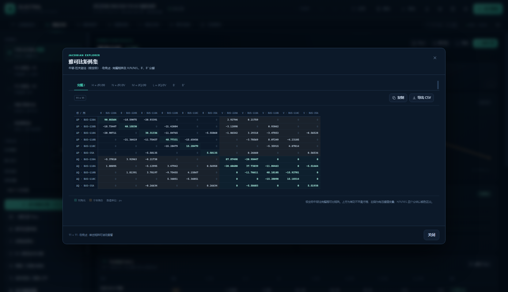

### 5. 潮流计算

支持的求解器：

1. **牛顿-拉夫逊法（极坐标完整雅可比）**
2. **PQ 分解法 · XB 方案**
3. **PQ 分解法 · BX 方案**
4. **高斯-赛德尔迭代法**
5. **直流潮流法**

功能包括：

- 收敛精度、最大迭代次数、阻尼系数可调。
- 自动检测电气岛；每个电气岛必须有平衡节点。
- 自动合并闭合开关节点。
- **PV 节点无功限值校核**：勾选后，若发电机无功越限，自动按限值转为 PQ 节点并重新求解。
- 输出母线电压、相角、发电机 P/Q、负荷、支路首末端功率、损耗、电流、热稳定负载率。
- 电压越限、支路过载、无功越限自动告警。
- 收敛曲线、电压分布图。
- **多算法对比**：同一网络、同一平启动条件下并排比较五种算法的收敛性与结果。
- **N-1 静态安全扫描**：逐条停运线路 / 双绕组 / 三绕组变压器 / 发电机并重新求解，给出不收敛、严重越限、一般告警与通过四类排序，支持 CSV 导出。

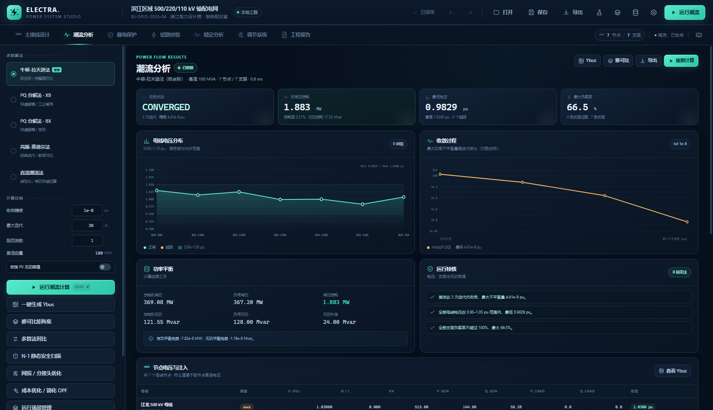

### 6. 继电保护整定与灵敏度扫描

保护功能库覆盖 **51 种主流保护**：

- **线路 18 种**：相间/接地距离、纵联差动、纵联方向、方向过流、零序过流/方向、负序过流、过负荷、过/低电压、断路器失灵、重合闸、故障测距、振荡闭锁、非全相、弱馈等。
- **变压器 20 种**：差动、差动速断、二次/五次谐波制动、过励磁、过流、零序/中性点/间隙零序、过负荷、过/低电压、油温、绕组温度、瓦斯、压力释放、冷却器故障、有载调压闭锁、阻抗后备等。
- **母线 13 种**：母差、母线过流、断路器失灵、死区、充电保护、PT/CT 断线、绝缘监视、弧光、低频减载、过频、备自投、联锁等。

线路、变压器和母线保护共用统一的功能配置、定值校验、Excel JSON 导出和报告表格。母线保护按母线对象独立建模，支持 CT/PT、母线短路电流与保护功能分布展示。


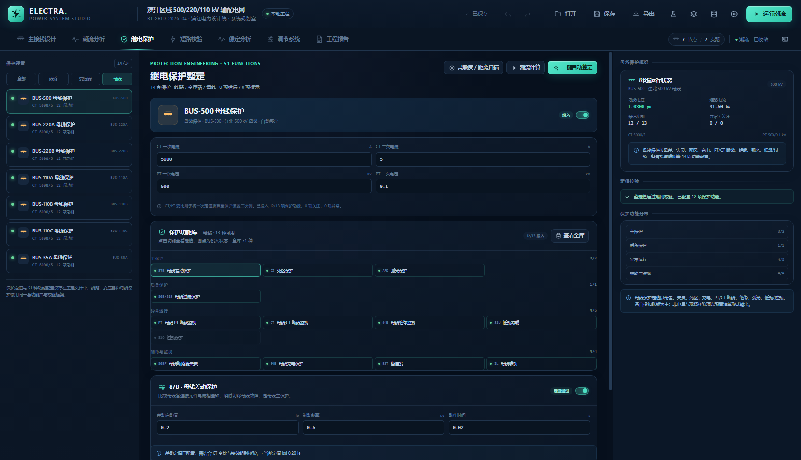

- 每一条线路 / 双绕组变压器 / 母线自动生成一套保护，也可自动补齐；母线保护独立按母线对象建模。
- 线路保护：三段式距离保护 + 过流后备保护。
- 变压器保护：比率制动差动保护 + 过流后备保护。
- CT / PT 变比、二次值折算。
- 手动修改任一定值后自动切换为“手动定值”。
- **一键自动整定全部保护**：
  - 根据最大负荷电流与额定电流选择标准 CT 变比；
  - 距离保护按实际正序线路阻抗整定 I 段 80%、II 段 120%（并延伸覆盖相邻线路 50%）、III 段延伸至相邻元件；
  - 过流保护按负荷电流选取启动值，按电气深度生成初值，再在共享母线处显式校核 **0.30 s 时间级差**，必要时自动抬高上游 TMS；
  - 自动生成二次值折算与整定计算书。
- 保护定值规则校验：CT 饱和、启动值、距离段次序、时间次序、差动斜率等。
- 过流反时限曲线：标准 / 非常 / 极端 / 长反时限与定时限，故障电流标记与动作时间读数。
- **灵敏度 / 距离覆盖扫描**：
  - 近端：被保护支路对端母线三相短路；
  - 远端：下一级母线三相短路；
  - 计算流过保护的故障电流、`Ksen = I_f / I_op`、距离 I 段范围、II/III 段相邻线路覆盖；
  - 给出通过 / 关注 / 不合格分类与 CSV 导出。

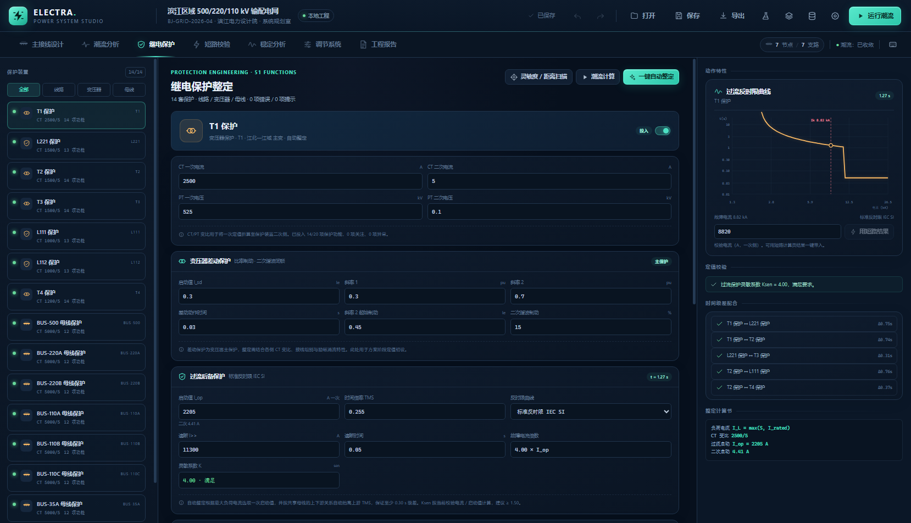

### 7. 重合闸与自动化

- 每条线路保护增加自动重合闸配置：投退、重合次数、死区时间、重合确认时间。
- 重合闸时序按过流保护动作时间、断路器分闸时间与死区时间生成。
- 可同时查看瞬时性故障（第一次重合成功）与永久性故障（达到次数后闭锁）的动作表。
- 重合器、分段器、熔断器可作为独立开关设备建模；重合器/分段器的自动逻辑目前作为定值与时序记录。

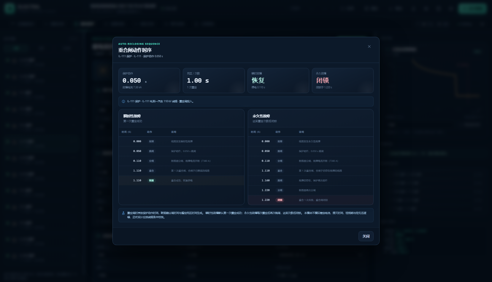

### 8. 短路电流校验

- 选择故障母线、**三相 / 两相 / 单相接地**、电压系数 `c`、系统短路容量、故障阻抗。
- 故障电流限制器在短路计算中自动切换为故障态高电抗；串联电抗器按其正序/零序电抗限制短路电流。
- 由正序节点导纳矩阵求解戴维南等值阻抗 \(Z_{th}\)。
- 三相 / 两相计算：
  - 对称短路电流 \(I''_k\)
  - 短路容量 \(S''_k\)
  - 冲击电流 \(i_p\)
  - 等值 R/X 与 X/R
  - 各母线残压与电压暂降
  - 各支路故障电流
  - 外部系统、发电机与**电动机反馈**贡献
- 单相接地计算：
  - 对称分量法，取 \(Z_2 \approx Z_1\)；
  - 组集零序网络并求 \(Z_0\)；
  - \(I_1=I_2=I_0=\dfrac{cU_n}{Z_1+Z_2+Z_0+3Z_f}\)，故障相电流 \(I_f=3I_0\)；
  - 输出序电流、序阻抗、A 相残压、各母线相电压；
  - 三绕组零序通路按阻断处理。
- 母线短路耐受电流（kA）可在母线属性中配置，单点结果自动校核开断能力。
- **全网短路电流扫描**：逐条母线计算并排序，校核每条母线是否超出短路耐受值，支持 CSV 导出与跳转至最大故障点。
- 结果可一键带入继电保护校验电流，支持 CSV 导出。

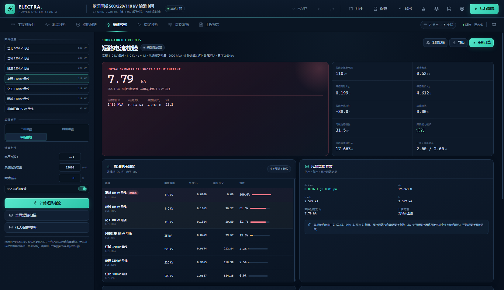

> 短路计算采用 IEC 60909 简化网络：电源取 `c·Un` 内电势，正序网络忽略负荷（电动机反馈可选），发电机以次暂态电抗等值，两相按 `Z₂≈Z₁`，单相按 `Z₂≈Z₁` 且三绕组零序阻断。可用于方案阶段设备与保护初筛，不替代完整 IEC 60909 / 继电保护整定程序。

### 9. 电压 / 频率调节系统

- **电压平衡**：以目标电压带内偏差平方和最小为目标，协调 PV/Slack 电压设定、变压器分接头与现有补偿容量；每步完整潮流校验，可一键应用。
- **频率平衡**：发电机跳机 / 负荷突增 / 有功盈余后，积分转子惯量、负荷阻尼、一次调频与 AGC 二次调节。
- 输出最低频率、最终频率、RoCoF、系统惯量、旋转备用、AGC 调节量、机组一次调频 / AGC 分配表。
- 频率低点与最终恢复分开判定：可识别“最终恢复但最低频率越限”的运行方式。

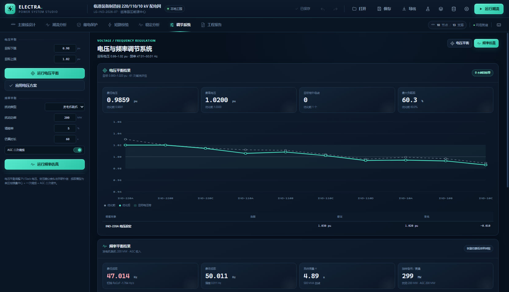

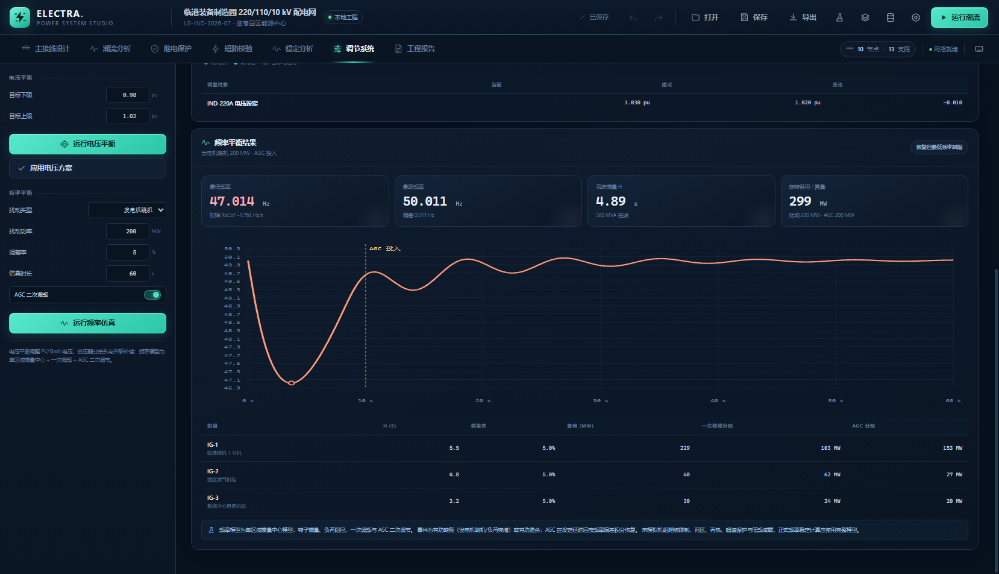

### 10. 暂态稳定分析

- 经典二阶发电机模型：恒定 \(E'\)、暂态电抗 \(x'_d\)、惯性时间常数 \(H\)、恒定阻尼。
- 负荷按故障前电压折算为恒阻抗，网络经 Kron 降阶到发电机内节点与固定电压平衡节点。
- RK4 时域积分，可设置故障母线、故障起始时刻、切除时间、仿真时长和步长。
- 输出：
  - 发电机相对惯性中心（COI）功角曲线；
  - 转速偏差曲线；
  - 最大功角差、末段转速偏差、稳定判定；
  - 动态机组参数表；
  - **临界切除时间估算**（二分搜索）。
- 故障点只能选择非平衡母线；平衡节点按无穷大母线处理。

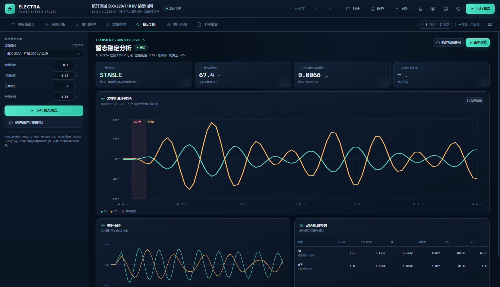

> 该模块用于方案阶段首摆稳定初筛：不含励磁、调速器、PSS、电动机动态、保护动作与连续故障序列。正式稳定计算应使用完整机电暂态程序。

### 11. 运行场景、网损优化与简化 OPF

**运行场景**：

- 保存当前母线类型/电压、机组出力、负荷、开关、分接头和补偿容量；
- 一键应用场景，快速切换夏季高峰、冬季低谷、风电大发、检修方式等；
- 多个场景 + 当前方式批量潮流对比，输出最低/最高电压、网损、最大负载率、越限数量，支持 CSV 导出；
- 场景只改变运行参数，不复制设备本体；新增设备不会被旧场景覆盖。

**网损 / 分接头优化**：

- 以总有功损耗为目标，坐标搜索双绕组/三绕组分接头、现有补偿容量、PV/Slack 电压设定；
- 每一步用完整交流潮流校验，电压约束 0.95–1.05 pu、支路负载率 ≤100%；
- 输出优化前后指标、建议调整清单和 CSV，可一键写回工程并重新计算。

**成本优化 / 简化 AC OPF**：

- 目标为发电成本 \(\sum (a_i + b_i P_i)\)；
- 在网损优化变量基础上增加非平衡机组有功再调度（受 Pmin/Pmax 约束）；
- 仍采用启发式坐标搜索，不保证全局最优；结果定位为工程方案阶段的快速寻优。

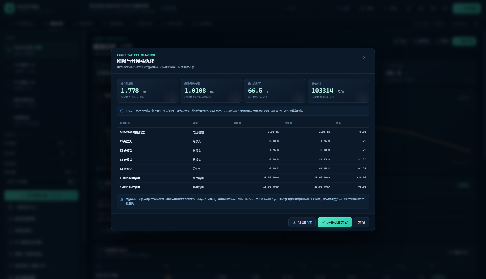

### 12. 数据导入 / 导出

- **Excel 工作簿**：SpreadsheetML 2003 `.xls`（XML）格式，包含工程、母线、支路、设备、保护五个工作表；可用 Excel 打开，按本工具表头修改后可重新导入。导入按 ID 匹配更新，新增行会创建对象。
- **设备清单 CSV**：扁平表，适合批量核对、资产盘点或导入数据库。
- **CIM RDF**：CIM 16 子集，包含 `BusbarSection`、`ConnectivityNode`、`Terminal`、`ACLineSegment`、`PowerTransformer` / `PowerTransformerEnd`、`EnergyConsumer`、`SynchronousMachine`、`ShuntCompensator`。
- **PSD-BPA 风格卡**：按 `B / G / L / T` 卡片导出母线、机组、负荷、线路和变压器，供交换与人工复核。该文件不是经过认证的 BPA 生产卡，正式计算前需按目标程序补全控制卡。
- JSON 工程文件仍是最完整的保存格式，包含全部设备、保护、场景和视图状态。

> Excel 导入只支持本工具导出的 SpreadsheetML 2003 XML（`.xml/.xls`），不支持二进制 `.xlsx`；CIM / BPA / CSV 当前为单向导出适配器。


### 13. 工程报告

- 自动编排 A4 设计计算报告：工程概况、主接线图、计算模型、潮流结果、保护定值、灵敏度扫描、短路结果、全网短路扫描、N-1 扫描、暂态稳定、电压/频率调节、结论与建议、签署栏。
- 浏览器打印 / 导出 PDF。
- 导出独立 HTML 文件，可离线打开。

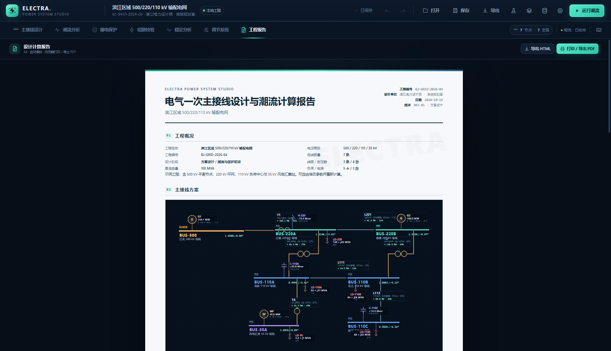

### 14. 示例电网库

内置三套可直接加载的完整工程：

| 示例 | 规模 | 特点 |
| --- | --- | --- |
| 滨江区域输配电网 | 7 母线 / 7 支路 / 11 设备 | 500/220/110/35 kV，500 kV 平衡节点、220 kV 环网、110 kV 负荷中心、35 kV 风电 |
| 临港装备制造园 | 10 母线 / 13 支路 / 12 设备 | 220/110/10 kV，双回进线、110 kV 环网、10 kV 馈线、电动机负荷与自备机组 |
| 华东 25 节点环网 | 25 母线 / 40 支路 / 28 设备 | 5 座 500 kV 枢纽、15 座 220 kV 变电站、5 座 110 kV 负荷站、6 台机组，适合大网潮流、矩阵、N-1 与稳定测试 |

入口：顶部烧瓶图标、左侧设备库底部“加载示例电网”，或潮流分析页的示例入口。加载会提示替换当前工程；大型示例默认使用简洁标注，可通过画布工具栏的眼睛图标切换。


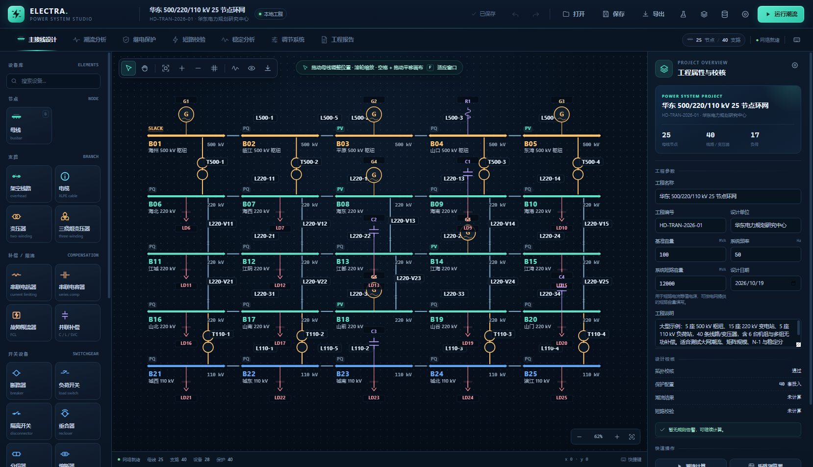

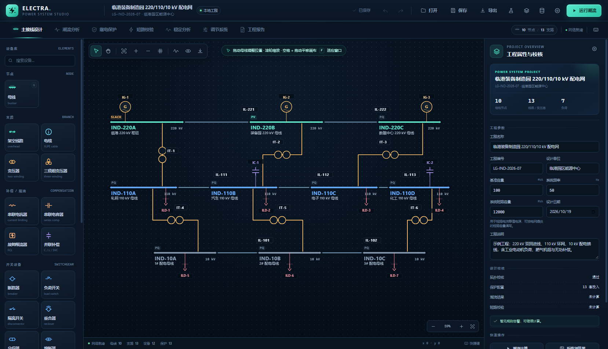

大型示例默认进入简洁标注模式；点击画布工具栏的眼睛图标可切换完整参数标注。

### 15. 工程管理与交互

- 自动保存到浏览器 localStorage；支持 JSON 工程导入导出。
- 撤销 / 重做（最多 60 个工程快照）。
- 键盘快捷键：`V` 选择、`H` 平移、`B` 母线、`F` 适应窗口、`Delete` 删除、`Ctrl+Z/Y` 撤销重做、`Ctrl+S` 保存、`Ctrl+Enter` 运行潮流、`Esc` 取消工具。
- 深色工程工作站界面，适配 1366px 以上桌面屏幕。
- 内置三套示例：7 节点区域输配电网、10 节点工业园区、25 节点 500/220/110 kV 复杂环网。

---

## 计算说明

### 基准与标幺值

- 系统基准容量默认 100 MVA，可在工程设置中修改。
- 各母线以自身额定电压为基准电压。
- 线路阻抗：\(Z_{pu} = Z_{\Omega} / (U_B^2/S_B)\)。
- 双绕组变压器阻抗折算：\(Z_{pu} = u_k \frac{S_B}{S_N} \left(\frac{U_{N1}}{U_{B1}}\right)^2\)。
- 三绕组变压器先由三个两两短路阻抗求星形分量，再按各侧容量与电压基准折算。
- 变压器变比标幺：\(a = \frac{U_{N1}/U_{N2}}{U_{B1}/U_{B2}}(1+\Delta t)\)，支持复变比相角偏移。

### 牛顿-拉夫逊法

极坐标功率方程：

\[
P_i = V_i\sum_j V_j(G_{ij}\cos\theta_{ij}+B_{ij}\sin\theta_{ij})
\]
\[
Q_i = V_i\sum_j V_j(G_{ij}\sin\theta_{ij}-B_{ij}\cos\theta_{ij})
\]

不平衡量按 `P_spec − P_calc`、`Q_spec − Q_calc` 组集，雅可比矩阵求解后更新相角与非 PV 节点电压幅值。收敛判据为最大功率不平衡量小于设定精度。

### PQ 分解法

- XB：`B′` 由串联电抗支路组集，`B″` 由完整节点电纳组集。
- BX：`B′` 取完整节点电纳（去并联支路），`B″` 取串联电抗支路。
- 迭代方程：`B′Δθ = ΔP/V`，`B″ΔV = ΔQ/V`。

### 短路电流

三相：

\[
Z_{th}=Z_{bus,kk},\quad I''_k=\frac{cU_n}{\sqrt3 |Z_{th}+Z_f|}
\]
\[
i_p=\kappa\sqrt2 I''_k,\quad \kappa=1.8
\]

单相接地：

\[
I_1=I_2=I_0=\frac{cU_n}{Z_1+Z_2+Z_0+3Z_f},\quad I_f=3I_0
\]

通过求解 `Y·Z_col = e_k` 获得故障点驱动点阻抗与转移阻抗，避免显式求逆；零序网络同理求解 `Y0·Z0_col = e0_k`。

### 暂态稳定

经典摇摆方程（标幺转速偏差 \(\Delta\omega\)）：

\[
\frac{d\delta}{dt}=\omega_s\Delta\omega
\]
\[
2H\frac{d\Delta\omega}{dt}=P_m-P_e-D\Delta\omega
\]

发电机内电势：

\[
E'=V_t+jx'_d I_g
\]

负荷恒阻抗折算：

\[
y_L=\frac{P_L-jQ_L}{V_0^2}
\]

网络 Kron 降阶后，用 RK4 同时积分所有动态机组。

### 优化目标

\[
\min f=\sum P_{loss}\quad\text{或}\quad \sum (a_i+b_iP_i)
\]

约束：\(0.95\le V_i\le1.05\)、支路负载率 \(\le100\%\)、分接头 \(\pm10\%\)、补偿容量在现有容量 0–200% 范围、非平衡机组 \(P_{min}\le P\le P_{max}\)。采用逐变量坐标搜索，每步完整潮流校验。

---

## 项目结构

```
F:\dshSoftware
├─ index.html                 应用入口
├─ styles.css                 深色工程工作站样式
├─ start.bat                  本地静态服务启动脚本
├─ js/
│  ├─ app.js                  应用编排、视图路由、项目/历史/场景/导出
│  ├─ model.js                数据模型、校验、序列化、迁移
│  ├─ data/
│  │  ├─ protectionCatalog.js 51 种保护功能目录
│  │  ├─ sample.js            示例库入口、7 节点区域电网、空白工程
│  │  ├─ largeExamples.js     10 节点工业园区、25 节点大电网
│  │  └─ exchange.js          Excel / CSV / CIM / BPA 适配器
│  ├─ engine/
│  │  ├─ complex.js           复数运算
│  │  ├─ linalg.js            实数 / 复数稠密线性方程求解
│  │  ├─ powerflow.js         Ybus、线路/双绕组/三绕组、五种潮流、雅可比
│  │  ├─ protection.js        保护整定、配合、灵敏度/距离扫描
│  │  ├─ shortcircuit.js      三/两/单相短路、零序网络、电动机反馈
│  │  ├─ contingency.js       N-1 静态安全扫描
│  │  ├─ optimize.js          网损 / 分接头 / 成本坐标搜索
│  │  ├─ stability.js         经典暂态稳定、临界切除时间
│  │  ├─ reclose.js           自动重合闸时序
│  │  ├─ regulation.js        电压平衡、频率响应 / AGC
│  │  └─ protectionFunctions.js 保护功能评估
│  └─ ui/
│     ├─ diagram.js           SVG 单线图编辑器与导出
│     ├─ inspector.js         设备属性面板
│     ├─ analysis.js          潮流分析页
│     ├─ protection.js        继电保护页
│     ├─ shortcircuit.js      短路校验页
│     ├─ stability.js         暂态稳定页
│     ├─ regulation.js        电压 / 频率调节页
│     ├─ scenarios.js         运行场景管理
│     ├─ examples.js          示例电网库
│     ├─ dataExchange.js      数据导入导出面板
│     ├─ report.js            设计报告
│     ├─ matrix.js            矩阵浏览器
│     ├─ charts.js            SVG 工程图表
│     ├─ modal.js             模态框
│     └─ icons.js             内联图标
├─ tests/engine.test.mjs      计算引擎自动化测试
└─ screenshots/               界面截图
```

---

## 测试

计算引擎不依赖浏览器，可直接用 Node.js 运行：

```bat
node --test tests/engine.test.mjs
```

当前覆盖（25 项）：

- Ybus 对称性、牛顿法功率平衡；
- PQ 分解 / 高斯-赛德尔与牛顿法结果一致性；
- 直流潮流、雅可比维度、闭合开关节点合并；
- PV→PQ 无功限值切换；
- 三绕组星形等值与三侧绕组功率；
- 三/两/单相短路、零序网络、母线耐受、全网扫描；
- 电动机反馈对短路电流的影响；
- 保护自动整定、配合校验、灵敏度/距离扫描；
- N-1 扫描（含三绕组停运）；
- 网损/分接头优化可行性与电压约束；
- 经典暂态稳定与临界切除时间；
- 三套示例电网的规模、网络校验、潮流收敛与电压/过载约束；
- 串联电抗器 / FCL 限流、扩展开关设备并网、SVC/STATCOM 静态无功等值；
- 电缆参数、自动重合闸时序、电压平衡与频率响应；
- 51 种保护功能目录、母线保护、功能定值校验与 Excel 保护配置 JSON 往返。

---

## 边界与后续方向

当前版本定位为**方案设计 / 教学演示 / 保护初设**工具，不宣称替代商业级电力系统分析软件。已知边界：

- 三绕组变压器零序通路、三侧差动保护暂未自动建模；单相接地时三绕组按零序阻断。
- 短路计算为简化 IEC 60909：正序网络忽略负荷（电动机反馈可选），单相按 `Z₂≈Z₁`，未做完整阻抗修正、电弧电阻、CT 饱和与断路器开断暂态。
- 保护灵敏度扫描以三相短路、支路最大电流近似流过保护的电流；正式整定应使用实测参数与装置说明书。
- 暂态稳定为经典二阶模型，不含励磁、调速器、PSS、电动机动态、保护动作和连续故障序列。
- 优化为启发式坐标搜索，不保证全局最优；成本系数与 Pmin/Pmax 需用户按机组实际填写。
- Excel 导入只支持本工具导出的 SpreadsheetML 2003 XML；CIM / BPA / CSV 为单向导出适配器，BPA 卡不是认证生产格式。
- N-1 扫描为静态安全初筛，不包含保护动作、再调度与连锁故障推演。

可扩展方向：完整三绕组零序与三侧差动、IEC 60909 完整阻抗修正、状态估计、小干扰稳定、谐波分析、保护整定书导出、CIM/BPA 双向适配。

---

## 说明

- 所有数据只保存在当前浏览器的 localStorage 与本地导出文件中，不上传服务器。
- 单线图与 SVG / PNG 导出均在浏览器端生成。
- 若需要在新浏览器中恢复，请使用“打开”导入之前导出的 JSON 工程文件。

---

## GitHub / 发行说明

本目录即 GitHub 仓库根目录（项目目录名 `Eletra`，产品名 `ELECTRA`）。

- 版本：`1.0.0`，见 `VERSION`
- 变更记录：`CHANGELOG.md`
- 发行说明：`RELEASE_NOTES.md`
- 发行资产：`release/ELECTRA-Power-Studio-v1.0.0.zip` 与 `release/SHA256SUMS.txt`
- 静态站点部署：`.github/workflows/pages.yml`，推送到 `main` 后在仓库
  **Settings → Pages → Source = GitHub Actions** 启用
- 本地测试：`npm test` 或 `node --test tests/engine.test.mjs`

```bash
git init
git add .
git commit -m "ELECTRA Power System Studio v1.0.0"
git branch -M main
git remote add origin <your-repository-url>
git push -u origin main
```

发布 GitHub Release 时使用 tag `v1.0.0`，上传 `release/` 下的 zip 和校验文件即可。
